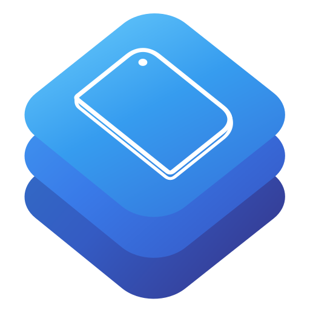

<p align="center">
  
</p>
<h1 align="center">SwiftDeviceKit</h1>
<p align="center">
  <a href="https://github.com/Anywhere-Music-Player/SwiftDeviceKit/releases/latest"></a>
  <a href="Package.swift"></a>
  <a href="#requirements"></a>
  <a href="LICENSE"></a>
</p>

SwiftDeviceKit identifies the iPhone, iPad, Apple Watch, Apple TV, Mac or Apple Vision Pro running your app. Based on [DeviceKit](https://github.com/devicekit/DeviceKit), it brings all six device families into one Swift catalog. An iPhone app can read Apple Watch specifications, and a native Mac app can identify its host and read its battery level when available.

## Features

Choose **SwiftDeviceKitCore** for the hardware catalog without UIKit. Choose **SwiftDeviceKitSystem** when you also need live readings. System includes every Core feature through the same `Device` type.

| Feature | Core | System |
| :--- | :---: | :---: |
| [Model name, device family, processor and simulator detection](#get-the-current-device) | ✓ | ✓ |
| SwiftUI preview detection in debug builds | ✓ | ✓ |
| [Screen size, pixel density and both iPhone Duo panels](#show-display-sizes-on-iphone-and-iphone-duo) | ✓ | ✓ |
| [Camera lenses and variable aperture](#check-camera-hardware), LiDAR, Dynamic Island and Action button | ✓ | ✓ |
| [Face ID, Touch ID and Optic ID hardware](#identify-the-biometric-sensor) | ✓ | ✓ |
| [Apple Watch screen resolution and Vision Pro display specifications](#read-apple-watch-and-vision-pro-display-specifications) | ✓ | ✓ |
| [Apple Pencil and wireless charging support](#check-accessory-support-on-iphone-and-ipad), USB-C | ✓ | ✓ |
| 5G, eSIM and dual eSIM capabilities | ✓ | ✓ |
| [OS name and version](#include-the-model-and-os-in-a-support-report), `isPhone` and `isPad` with iOS idiom fallback | — | ✓ |
| [Battery percentage and charging state](#display-battery-percentage-and-charging-status) on battery-equipped devices | — | ✓ |
| [Low Power Mode and thermal state](#defer-background-work-when-power-or-cooling-is-limited) | — | ✓ |
| [Available and total storage capacity](#check-space-before-a-download) | — | ✓ |
| [Current display pixels, brightness and Display Zoom](#read-the-current-display-settings), orientation and Guided Access where available | — | ✓ |

## Requirements

Both products require Swift tools 6.4+ and use Swift 6 language mode. Core provides the same 173-model catalog on every platform. System readings depend on the operating system and hardware.

| Device | Minimum OS | Examples of System readings |
| --- | --- | --- |
| iPhone | iOS 18 | Battery, brightness, orientation and Display Zoom |
| iPad | iPadOS 18 | The same readings as iPhone, including in iPhone-only apps |
| Apple Watch | watchOS 11 | Battery, thermal state, storage and display pixels |
| Apple TV | tvOS 18 | Connected display pixels, thermal state and free storage |
| Mac | macOS 15 | Host OS, main display pixels and internal battery when present |
| Apple Vision Pro | visionOS 2 | Battery when available, thermal state, storage and Guided Access |

The [platform guide](Docs/PlatformSupport.md) lists model coverage, API availability, Release client sizes and test results for each platform.

## Installation

In Xcode, choose **File → Add Package Dependencies…** and paste this URL.

```text
https://github.com/Anywhere-Music-Player/SwiftDeviceKit.git
```

For six-platform support, select the **Branch** dependency rule and enter `main`. Add one [product](#features) to your app target. The latest tagged release, [2026.1.1](https://github.com/Anywhere-Music-Player/SwiftDeviceKit/releases/tag/2026.1.1), supports iPhone and iPad.

## Usage

### SwiftDeviceKitCore

#### Get the current device

```swift
import SwiftDeviceKitCore

let device = Device.current
print(device.realDevice)   // e.g. iPhone 18 Pro
print(device.cpu)          // A20 Pro on iPhone 18 Pro
print(device.isSimulator)  // true in Simulator
```

#### Show display sizes on iPhone and iPhone Duo

Use `realDevice` to match the same model on hardware and in Simulator.

```swift
import SwiftDeviceKitCore

let model = Device.current.realDevice
if model == .iPhoneDuo {
    for screen in model.screens {
        print("\(screen.role) display · \(screen.diagonal)″")
    }
} else if let screen = model.screen(.main) {
    print("\(model) · \(screen.diagonal)″ display")
}
```

On iPhone 18 Pro this prints `iPhone 18 Pro · 6.3″ display`. On iPhone Duo it prints `outer display · 5.4″` and `inner display · 7.6″`. For the current window size, use your view’s geometry.

#### Identify the biometric sensor

```swift
import SwiftDeviceKitCore

let model = Device.current
if model.isFaceIDCapable {
    print("Face ID")
} else if model.isTouchIDCapable {
    print("Touch ID")
} else if model.isOpticIDCapable {
    print("Optic ID")
}
```

#### Check camera hardware

```swift
import SwiftDeviceKitCore

let device = Device.current
print(device.hasTelephotoCamera)  // true on iPhone 18 Pro, false on iPhone Duo
print(device.hasVariableAperture) // true on iPhone 18 Pro
```

#### Read Apple Watch and Vision Pro display specifications

```swift
import SwiftDeviceKitCore

let device = Device.current
if device.isWatch, let pixels = device.screen(.main)?.resolution {
    print("\(pixels.width) × \(pixels.height)")  // 416 × 496 on Apple Watch Series 12 (46 mm)
} else if let display = device.spatialDisplay {
    print(display.refreshRatesHz)  // [90, 96, 100, 120] on Apple Vision Pro (M5)
}
```

### SwiftDeviceKitSystem

Import System alone to use these examples. Access UIKit and WatchKit readings on the main actor.

#### Check accessory support on iPhone and iPad

```swift
import SwiftDeviceKitSystem

let device = Device.current
if device.isPhone && device.supportsWirelessCharging {
    print("This iPhone supports wireless charging.")
}
if device.isPad && device.applePencilSupport.contains(.pro) {
    print("This iPad supports Apple Pencil Pro.")
}
```

#### Include the model and OS in a support report

```swift
import SwiftDeviceKitSystem

let device = Device.current
if let name = device.systemName, let version = device.systemVersion {
    print("\(device.realDevice) · \(name) \(version)")
}
```

#### Display battery percentage and charging status

Available on iPhone, iPad, Apple Watch, Mac and Vision Pro. A desktop Mac without an internal battery returns `nil`.

```swift
import SwiftDeviceKitSystem

#if !os(tvOS)
@MainActor
func batteryLabel() -> String {
    switch Device.current.batteryState {
    case .charging(let percent): "\(percent)% · Charging"
    case .unplugged(let percent): "\(percent)%"
    case .full: "Fully charged"
    case nil: "Battery unavailable"
    }
}
#endif
```

For a percentage alone, use `Device.current.batteryLevel` on the main actor.

#### Defer background work when power or cooling is limited

```swift
import SwiftDeviceKitSystem

@MainActor
func shouldDeferBackgroundWork() -> Bool {
    let device = Device.current
    #if !os(tvOS)
    if device.batteryState?.lowPowerMode == true { return true }
    #endif
    switch device.thermalState {
    case .serious, .critical: return true
    default: return false
    }
}
```

#### Check space before a download

```swift
import SwiftDeviceKitSystem

func hasSpaceForDownload(bytes: Int) -> Bool? {
    Device.volumeAvailableCapacity.map { $0 >= bytes }
}
```

This works on all six platforms, including Apple TV. For a user-requested download on iPhone, iPad, Mac or Vision Pro, `volumeAvailableCapacityForImportantUsage` also accounts for space the OS can reclaim.

#### Read the current display settings

```swift
import SwiftDeviceKitSystem

#if !os(visionOS)
let device = Device.current
if let pixels = device.currentDisplayPixels {
    print("\(pixels.width) × \(pixels.height)")  // Connected display on Apple TV
}
#if os(iOS)
print("Brightness: \(device.screenBrightness)%")
if device.isZoomed == true {
    print("Display Zoom is enabled.")
}
#endif
#endif
```

## Documentation

- [Platform support and verification](Docs/PlatformSupport.md)
- [Migrating from DeviceKit](Docs/Migration.md)
- [Screen specifications](Docs/Screens.md)
- [Adding a model](Docs/Catalog.md) and [testing the catalog](Docs/Testing.md)
- [Changelog](CHANGELOG.md)

SwiftDeviceKit is distributed under the [MIT license](LICENSE). See [attribution](ATTRIBUTION.md) for the original authors and sources.
